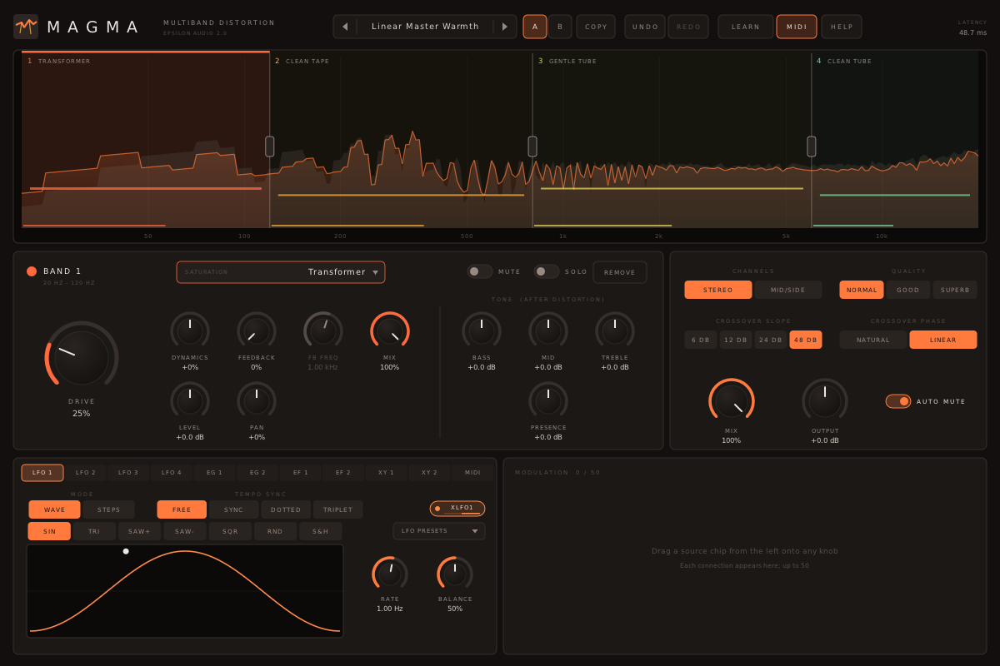

# Magma

**A multiband distortion plugin with a drag-and-drop modulation system, for macOS, Windows and Linux (VST3 · AU · CLAP · VST2).**

Part of **[Epsilon Audio](https://github.com/natehouk/epsilon-plugins)**, a family of free, open-source plugins: Monolith, Caldera, Obsidian, Strata, Basalt, Gneiss, Mica, Flint, Granite, Magma, Schist, Slate and Talc.



Magma is a clean-room design with the feature set of FabFilter Saturn, FabFilter's eleventh plugin (March 2012). It was written from scratch, working only from FabFilter's public release announcement and contemporary reviews. No FabFilter code, binaries, presets, artwork or trademarks were used.

It is part of a family of plugins:
- [Monolith](https://github.com/natehouk/monolith) (synth)
- [Caldera](https://github.com/natehouk/caldera) (filter)
- [Obsidian](https://github.com/natehouk/obsidian) (polysynth)
- [Strata](https://github.com/natehouk/strata) (tape delay)
- [Basalt](https://github.com/natehouk/basalt) (live dual filter)
- [Gneiss](https://github.com/natehouk/gneiss) (compressor)
- [Mica](https://github.com/natehouk/mica) (equalizer)
- [Flint](https://github.com/natehouk/flint) (small filter)
- [Granite](https://github.com/natehouk/granite) (limiter)
- **Magma**, molten rock

## Download

Get the latest build from [**Releases**](../../releases):

| Platform | File | Contains |
|---|---|---|
| macOS 10.13+ (Apple Silicon + Intel) | `Magma-macos-universal.zip` | VST3, AU, CLAP, manual |
| Windows x64 | `Magma-windows-x64.zip` | VST3, CLAP, VST2, manual |
| Linux x64 | `Magma-linux-x64.zip` | VST3, CLAP, VST2, manual |

### Install

| Platform | Copy | To |
|---|---|---|
| macOS | `Magma.vst3` / `Magma.component` / `Magma.clap` | `~/Library/Audio/Plug-Ins/VST3` / `Components` / `CLAP` |
| Windows | `Magma.vst3` (folder) / `Magma.clap` | `C:\Program Files\Common Files\VST3\` / `CLAP\` |
| Linux | `Magma.vst3` / `Magma.clap` | `~/.vst3/` / `~/.clap/` |

**macOS:** the plugins are ad-hoc signed, not notarized. After copying, run:

```
xattr -dr com.apple.quarantine ~/Library/Audio/Plug-Ins/*/Magma*
```

## Features

**Bands**
- **Up to six bands.**
  - Double-click the display to split a band.
  - Drag crossovers to move them.
  - Right-click a crossover to merge two bands.
- **Linkwitz-Riley crossovers** at 12, 24 or 48 dB/oct, with phase compensation. The bands always sum flat; tests show 6 bands with no drive within 0.02 dB.
- **Interactive display** shows:
  - input and output spectrum
  - band regions with their styles
  - drive lines you can drag
  - live modulation markers
  - band activity

**16 distortion styles**

| Family | Styles |
|---|---|
| Tube | Clean, Warm, Hot, Broken |
| Tape | Clean, Warm, Hot |
| Amp | Clean, Crunch, Lead (with speaker cabinet) |
| Saturation | Soft, Hard Clip |
| Experimental | Rectify, Crush (bit/sample-rate), Smear (grain feedback), Fold (wavefolder) |

Drive is **level-compensated**: every style stays within about 2 dB of the input level at any drive, so you hear character, not volume.

**Per band**
- Drive and dynamics (compress or expand)
- Feedback with its frequency
- Bass, mid, treble and presence after the distortion (negative presence acts as a cabinet roll-off)
- Mix, level and pan
- Mute and solo

**Global**
- Stereo or mid/side
- Normal (2×) or HQ (8×) oversampling
- Auto-mute for feedback
- Global mix, time-aligned with the dry signal
- Output gain

**Modulation**
- **50 slots, drag and drop:** drag a source's chip onto any knob.
  - Modulated knobs show their range and a live position dot.
  - A slot's amount can be modulated by another slot.
- **Sources:**
  - 4 **XLFOs**: 7 waveforms or a 16-step sequencer with glide, free or tempo-synced (straight, dotted, triplet)
  - 2 **envelope generators**: MIDI- or audio-triggered
  - 2 **envelope followers**: input or sidechain
  - 2 **XY pads**: X and Y each a source
  - **MIDI**: velocity, key, mod wheel, pitch bend, aftertouch
- **140 destinations:**
  - every continuous band control
  - crossovers
  - global mix and output
  - LFO rates and balances
  - envelope stages
  - slot amounts

**Workflow**
- A/B with copy
- Undo/redo for every edit, including adding and removing bands
- MIDI Learn
- Smoothed, sample-accurate automation (418 parameters)
- Resizable interface
- **42 factory presets** in seven categories, plus user presets
- **Hover tips** everywhere, a **HELP window**, and a **[full manual](docs/MANUAL.md)** (also in every release zip as `Magma-Manual.html`)

### Compared with FabFilter Saturn (2012)

| Saturn | Magma |
|---|---|
| Multiband processing, up to six bands | ✓ |
| Sixteen distortion styles (tube, tape, amp, saturation, creative) | ✓ 16 styles in the same five families |
| Per-band drive, mix, feedback, dynamics, tone and level | ✓ plus pan, mute and solo |
| Mid/side processing | ✓ |
| Optional HQ mode, 8× oversampling | ✓ |
| XLFOs (16-step), XY controllers, envelope generators, envelope followers, MIDI sources | ✓ |
| Drag-and-drop modulation, 50-slot matrix, source visualisation | ✓ |
| Interactive multiband display | ✓ |
| MIDI Learn, undo/redo, A/B, parameter interpolation, sample-accurate automation | ✓ |
| Over 150 factory presets | 42 factory presets |
| Normal and wide layouts | One resizable layout with the modulation section always visible |
| Stereo and mono versions | Stereo |
| Pro Tools (RTAS/AAX/AudioSuite) | Not supported (needs Avid's SDK and signing) |

## Build from source

The plugin is built on [DPF](https://github.com/DISTRHO/DPF):

```
git clone --recursive https://github.com/DISTRHO/DPF.git dpf
make -C plugins/Magma                    # Linux / macOS (macOS also builds the AU)
make -C plugins/Magma WINDOWS=true CC=x86_64-w64-mingw32-gcc CXX=x86_64-w64-mingw32-g++
```

GitHub Actions builds all three platforms on every push. The macOS build is universal and ad-hoc signed. A `v*` tag, or a release published on GitHub, attaches the zips to that release.

## Tests

```
cd tests
g++ -O2 -std=c++11 features.cpp -o features && ./features   # flat band sum, level compensation for all styles, harmonics, band isolation,
                                                            # mute/solo/level/pan, tone, dynamics, feedback + auto-mute, mid/side,
                                                            # aligned mix, XLFO, steps, EG, EF (sidechain), XY, MIDI, slot-on-slot
g++ -O2 -std=c++11 fuzz.cpp -o fuzz && ./fuzz               # random parameters, modulation and MIDI at 44.1-192 kHz: always finite
g++ -O2 -std=c++11 presets.cpp -o presets && ./presets      # plays a test mix through every preset
g++ -O3 -std=c++11 bench.cpp -o bench && ./bench            # CPU, 1/3/6 bands, normal and HQ
```

CPU use with modulation running:

| Bands | Normal (2×) | HQ (8×) |
|---|---|---|
| 1 | 1.5% | 4.6% |
| 3 | 3.3% | 13% |
| 6 | 9.5% | 26% |

Release checks:
- Steinberg's VST3 validator passes 47/47.
- The interface is exercised with scripted input and a live test mix:
  - splitting and merging bands, undo
  - the style picker
  - drag-and-drop modulation, the step sequencer, the XY pad
  - presets, tips and help

## Source layout

| File | Contents |
|---|---|
| `plugins/Magma/MagmaEngine.hpp` | All DSP: crossovers, styles, band processing, oversampling, modulation sources and matrix. Header-only |
| `plugins/Magma/ParamDefs.hpp` | Parameter names, labels, value mapping, source and destination names |
| `plugins/Magma/Presets.hpp` | Factory presets |
| `plugins/Magma/UserPresets.hpp` | User preset files |
| `plugins/Magma/Help.hpp` | Hover tip text and in-plugin help pages |
| `plugins/Magma/MagmaPlugin.hpp/.cpp` | Plugin wrapper: parameters, MIDI, tempo, sidechain, latency, MIDI Learn |
| `plugins/Magma/MagmaUI.cpp` | Custom vector interface (NanoVG) |
| `plugins/Magma/Fft.hpp` | Small FFT for the analyser |
| `docs/MANUAL.md` | User manual (`Magma-Manual.html` is generated from it with pandoc) |

## License

[MIT](LICENSE). Built with [DPF](https://github.com/DISTRHO/DPF) and its bundled NanoVG, which are under the ISC license. `plugins/Magma/ResizeHandle.hpp` comes from DPF's examples and keeps its ISC notice.

"FabFilter" and "FabFilter Saturn" are trademarks of FabFilter Software Instruments. Magma is not affiliated with or endorsed by FabFilter.
